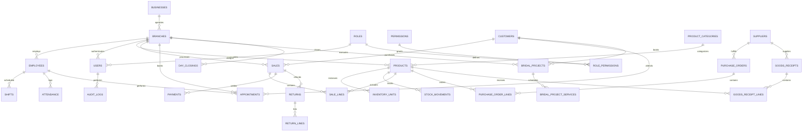

# Database Schema & Entity Relationship Diagram (ERD)

PostgreSQL schema for **Royal Heritage Bridal, Beauty & Fashion Jewellery POS and Retail ERP**.

## Schema Highlights

1. **Transactional Integrity & Idempotency**:
   - `idempotency_key` (UUID) is strictly enforced on `sales`, `returns`, and `payments`.
   - Concurrency is protected using `FOR UPDATE` row locks inside the `process_pos_sale` stored procedure.

2. **Inventory Tracking**:
   - High-value jewellery items (Kundan, Polki, Diamond sets) are tracked with unique serialized RFID/barcode tags via `inventory_units`.
   - General retail cosmetics and salon consumables are tracked via standard quantity counts in `products`.
   - Every physical stock change produces an immutable audit record in `stock_movements`.

3. **Financial Audit Trail**:
   - Financial adjustments are strictly append-only (returns, refunds, and discounts generate credit memos and audit rows; past sales are never deleted).
